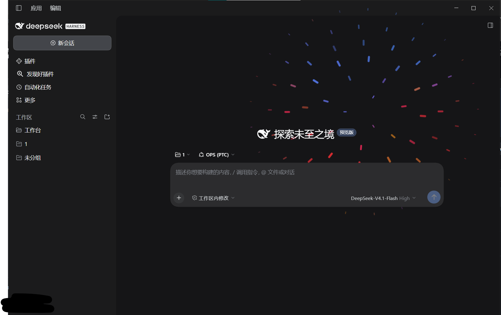

# dsh-hero-animation

Animated capsule dot field for the DeepSeek Harness new-session ("hero") screen.

[中文说明](./README.zh-CN.md)



## What it does

Registers a component on the `conversation.hero.frame` slot and draws an animated
field of 84 colored capsules behind the new-session content. The canvas is
`position: fixed; inset: 0; z-index: -1; pointer-events: none`, so it never
intercepts clicks or keyboard input.

Visual behaviour:

- **Firework-like bloom** — capsules are laid out on a golden-angle spiral and
  pushed outward by concentric wave fronts, so the field opens up like a firework
  burst and keeps breathing while it drifts.
- **Gradient colour** — every capsule picks its tone from a five-stop colour ramp
  (dark green → amber → magenta → violet → blue) driven by a slowly moving noise
  field, which is why neighbouring capsules blend into each other instead of
  showing as flat blocks of colour.
- **Pointer following** — the whole field eases toward the mouse pointer
  (`pointermove`, lerp factor `0.075` per frame), and capsules near the cursor
  swell and rotate to face it.

Everything is drawn with the Canvas 2D API; there is no WebGL and no dependency
beyond React.

## Install

```sh
dsh plugin --profile <profile> add github:FRRR145/dsh-hero-animation
```

or, from a local checkout:

```sh
dsh plugin --profile <profile> add link:/absolute/path/to/dsh-hero-animation
```

Restart the host afterwards — client bundles are loaded at startup.

## Compatibility

- Requires DeepSeek Harness 0.2.x with the `conversation.hero.frame` slot
  (slot kind: `hoc`, declared by `@deepseek-ai/dsh-client-ui-conversation`).
- Tested against DSH `0.2.2-rc.5`. If the slot contract changes upstream, the
  component simply will not mount; it does not patch any global state.

## How it works

| Piece | Detail |
|---|---|
| Slot | `conversation.hero.frame`, registered with id `hero-animation` |
| Rendering | Canvas 2D, one `requestAnimationFrame` loop, paused on unmount |
| Sizing | Canvas dimensions follow `devicePixelRatio`, capped at 2 |
| Input | `pointermove` / `resize` listeners, removed on cleanup |
| Visuals | 84 capsules, 7-color palette, wave + pointer-field distortion |

## Files

| File | Purpose |
|---|---|
| `client.js` | The animation and the slot registration |
| `index.js` | Host half — intentionally empty |
| `cordis.patch.yml` | Bundle declaration |

## License

MIT
